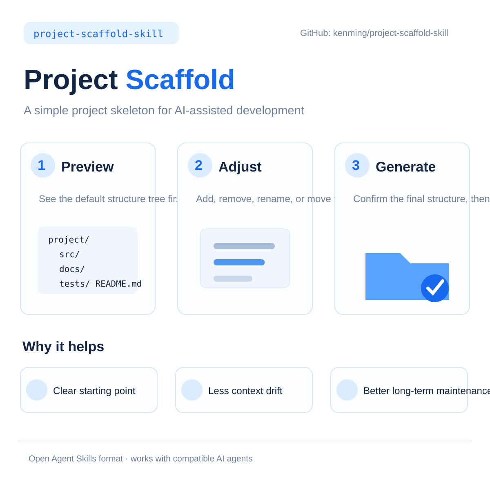
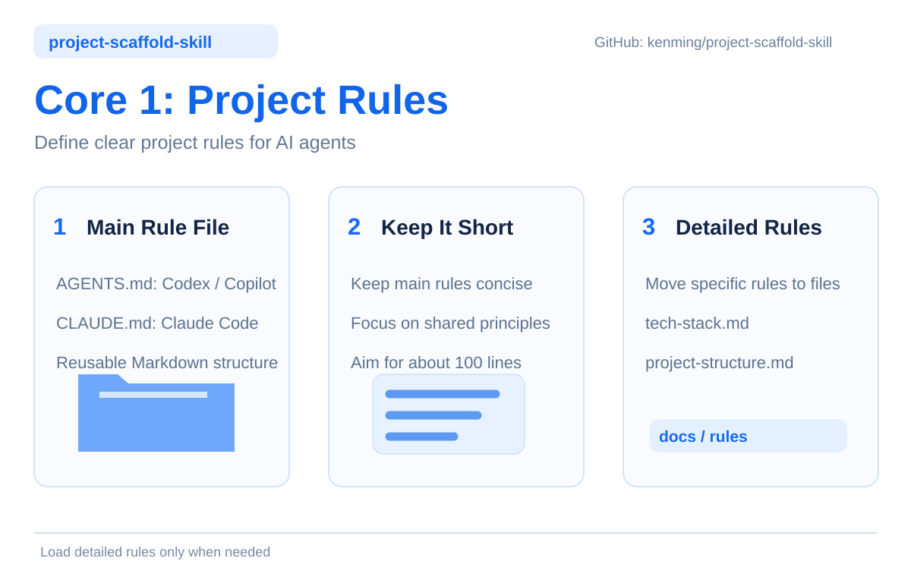
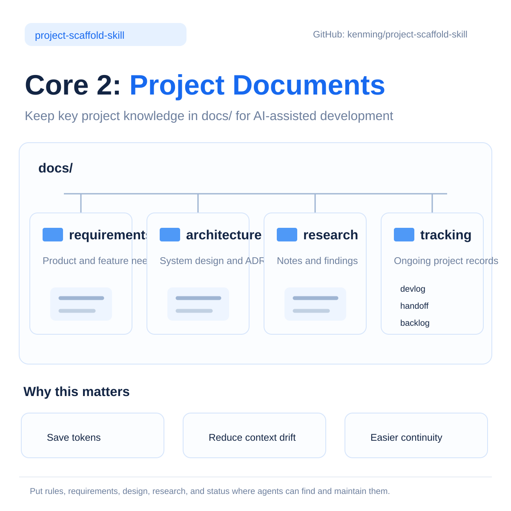

# Project Scaffold

English | [繁體中文](README_zh-TW.md)

An Agent Skill for creating a project scaffold through an annotated directory preview. Describe the changes you want, review the updated tree, and confirm before files are created.

<p align="center"></p>

## Purpose and intended use

Project Scaffold prepares the instructions and documentation structure for software development with an Agent. Its purpose is to establish where project rules, requirements, research, architecture decisions and tracking records belong, so developers and Agents can work from a consistent starting point.

<p align="center"></p>

It is suitable for initializing or organizing projects such as:

- Web applications and websites.
- Mobile and desktop apps.
- Backend services, APIs and business application systems.
- CLI tools, automation utilities and reusable Agent Skills.

The scaffold is independent of programming languages and frameworks. It creates organizational directories and rule templates; application source code, dependencies, builds and deployment remain part of the subsequent development work. Teams can adapt it to a new project or selectively add missing structure to an existing one.

<p align="center"></p>

## Installation

Prerequisites: an Agent that can read local Skill instructions and operate files, plus Node.js 24+ for generation.

User-level global installation is recommended: install once and reuse across projects. The installation folder stores the Skill; generated files go to the current project or an explicitly selected target.

This Skill follows the [Agent Skills open specification](https://agentskills.io/specification), used by Codex, GitHub Copilot, Claude Code and other compatible Agents. The specification defines the Skill package structure; installation locations depend on the Agent.

1. Obtain the [`skills/project-scaffold/`](skills/project-scaffold/) folder from this repository.
2. Copy the complete folder into the user-level skills directory for your Agent, using the table below.
3. Open the target project in your Agent and invoke `project-scaffold`. If it is not discovered, explicitly attach or point to the installed `SKILL.md`.

| Agent | Global installation folder | Windows equivalent |
| --- | --- | --- |
| [Codex](https://learn.chatgpt.com/docs/build-skills#where-codex-loads-local-skills), [GitHub Copilot CLI](https://docs.github.com/en/copilot/how-tos/copilot-cli/customize-copilot/add-skills) | `~/.agents/skills/project-scaffold/` | `%USERPROFILE%\.agents\skills\project-scaffold\` |
| [Claude Code](https://code.claude.com/docs/en/skills#choose-where-skills-load) | `~/.claude/skills/project-scaffold/` | `%USERPROFILE%\.claude\skills\project-scaffold\` |

Other compatible Agents may also discover `~/.agents/skills/`; check their documentation. The following example uses the shared directory:

```text
user-home/
└── .agents/
    └── skills/
        └── project-scaffold/
            ├── SKILL.md
            ├── scripts/
            ├── assets/
            └── references/
```

For project-only use or a version maintained with the repository, use `<project>/.agents/skills/project-scaffold/` for Codex or Copilot CLI, or `<project>/.claude/skills/project-scaffold/` for Claude Code.

Copy the Skill and its supporting resources, not just SKILL.md. You do not need `npm install` or a build step for normal use.

## Usage

1. In the target project, load the installed Skill as described above.
2. Ask: “Use project-scaffold to preview a scaffold for this project. Let me adjust the tree before creating files.”
3. Request any additions, removals, renames or moves. Confirm the final preview when ready.

For a quick review without installation, attach the distribution's [SKILL.md](skills/project-scaffold/SKILL.md) directly and keep the entire Skill folder accessible to the Agent. Specify a temporary target location for an isolated test.

For example:

> Rename AGENTS.md to CLAUDE.md, remove guides, rename devlog to journal, and add meetings for meeting notes.

To review the interaction without creating files, say: “Simulate only. Do not write any files.” Confirmation in a simulation does not authorize actual generation.

## Default scaffold

```text
project-root/
├── AGENTS.md                   # Master instructions and rule index
├── .agent-rules/               # Subordinate rule templates
│   ├── tech-stack.md           # Technology stack
│   ├── project-structure.md    # Directory structure
│   ├── tracking.md             # Project tracking
│   └── verification.md         # Verification principles
└── docs/                       # Project documentation
    ├── requirements/           # Requirements
    ├── research/               # Research and evidence
    ├── architecture/           # Architecture documents
    ├── tracking/               # Tracking parent directory: logs and handoffs
    │   ├── devlog/             # Development and verification records
    │   └── handoff/            # Current state and next steps
    └── guides/                 # User and operation guides
```

Add or remove directories and documents, change their names or locations, and update their purposes. New items need a purpose; the Agent asks only when it is missing or a change is ambiguous. Renaming a parent moves its children in the preview.

## What it creates

- One master instruction file: AGENTS.md, CLAUDE.md or a custom Markdown filename.
- Selected subordinate rule templates with purposes, scopes and sections to complete later.
- Selected empty documentation directories and an accurate structure description when selected.

The interaction and generated prose follow the conversation language. User-provided names and descriptions are preserved. A custom master filename does not guarantee automatic discovery by every Agent.

The Skill does not conduct technical interviews, write PRDs or work records, prescribe their formats, install tools or skills, or execute Git operations. Removing an item from the proposed scaffold does not delete an existing project file.

## Runtime and validation

Node.js 24+ is required for generation. Compiled `.mjs` scripts are included; installing npm dependencies is unnecessary for normal execution. The Agent prepares the internal data and runs the scripts after confirmation.

The generator previews by default. Existing identical content is skipped; different content is reported as a conflict. There is no force-overwrite option or automatic rollback after a partial failure.

See [manual validation](skills/project-scaffold/references/manual-validation.md) for dialogue checks and optional script commands, and [internal input format](skills/project-scaffold/references/options.md) for development details.

File behavior has been tested on Windows. macOS, Linux and the quality of every conversation language have not been fully verified. Multi-file writes are not atomic; avoid concurrent changes to the target.

## Distribution

The self-contained Skill is in [`skills/project-scaffold/`](skills/project-scaffold/). Source TypeScript, compiled scripts, templates and supporting references are kept together.
