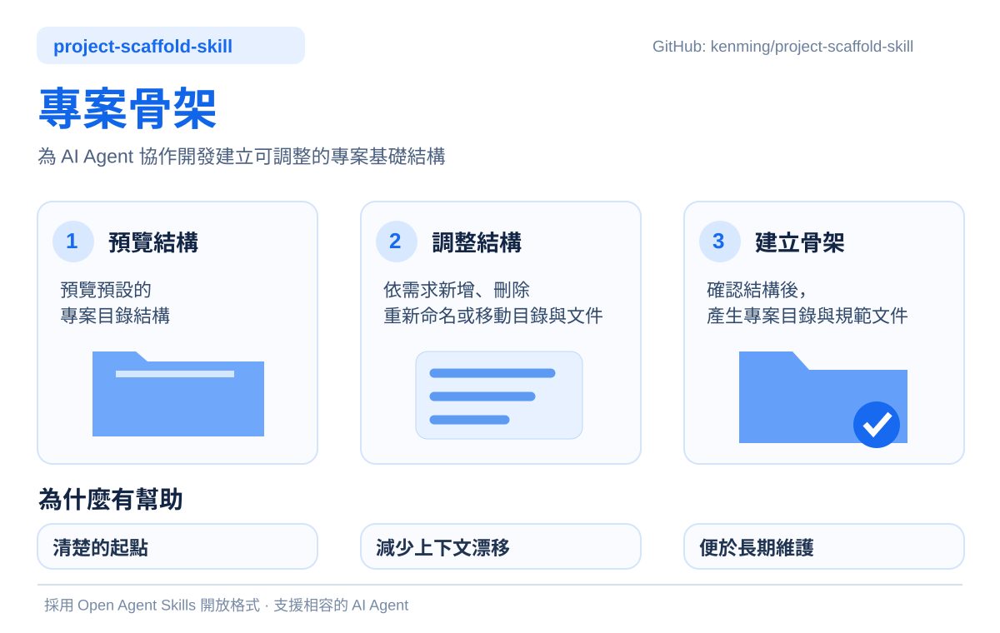
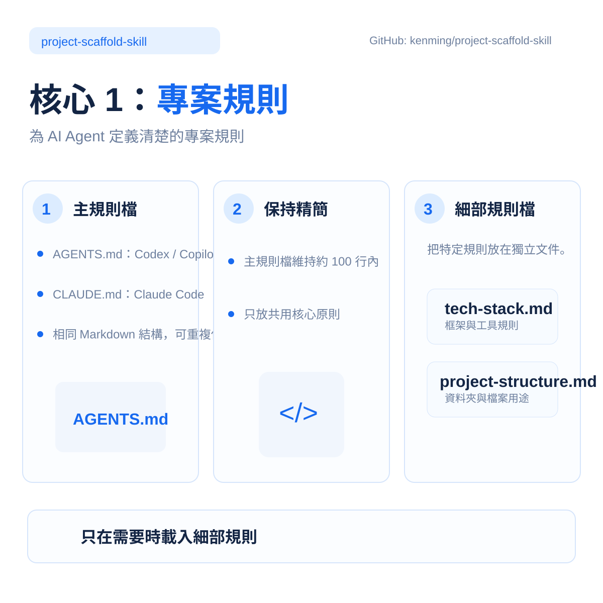
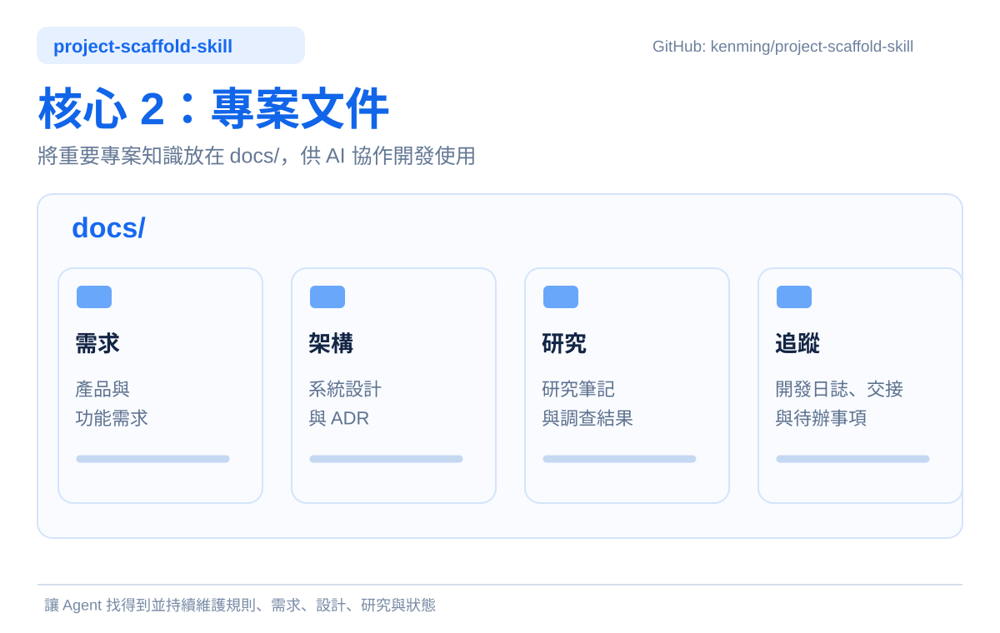

# Project Scaffold

[English](README.md) | 繁體中文

透過附用途註解的目錄樹預覽專案骨架。直接描述需要的修改，檢視更新後的結構，確認後才建立檔案。

<p align="center"></p>

## 專案定位與目的

Project Scaffold 是供開發者與 Agent 協作時使用的軟體專案初始化工具。目的在於先建立規範與文件的整理基礎，明確安排專案規則、需求、研究、架構決策及追蹤記錄的位置，讓後續開發有一致的起點。

<p align="center"></p>

適用於初始化或整理下列專案：

- Web 應用程式與網站。
- 行動 App 與桌面應用程式。
- 後端服務、API 與企業應用系統。
- CLI 工具、自動化工具及可重用的 Agent Skills。

模板不綁定程式語言或框架，生成範圍為整理用途的目錄與規範模板；應用程式原始碼、相依套件、建置與部署則在後續開發階段處理。新專案可直接採用，既有專案也可選擇性補齊缺少的結構。

<p align="center"></p>

## 安裝方式

使用條件：Agent 能讀取本地 Skill 指令並操作檔案；實際生成需 Node.js 24+。

建議採使用者層級的全域安裝，一次安裝即可跨專案重用。安裝目錄保存 Skill 本身；生成檔案則寫入目前專案或明確指定的目標位置。

本 Skill 採用 [Agent Skills 開放規格](https://agentskills.io/specification)，可供 Codex、GitHub Copilot、Claude Code 及其他相容 Agent 使用。規格定義 Skill 套件結構，安裝位置則依各 Agent 的載入機制決定。

1. 取得本儲存庫的 [`skills/project-scaffold/`](skills/project-scaffold/) 資料夾。
2. 將完整資料夾複製至所用 Agent 的使用者級 Skills 目錄，位置見下表。
3. 在 Agent 中開啟目標專案，呼叫 `project-scaffold`。若未自動發現，直接附上或指定已安裝的 `SKILL.md`。

| Agent | 全域安裝目錄 | Windows 對應位置 |
| --- | --- | --- |
| [Codex](https://learn.chatgpt.com/docs/build-skills#where-codex-loads-local-skills)、[GitHub Copilot CLI](https://docs.github.com/en/copilot/how-tos/copilot-cli/customize-copilot/add-skills) | `~/.agents/skills/project-scaffold/` | `%USERPROFILE%\.agents\skills\project-scaffold\` |
| [Claude Code](https://code.claude.com/docs/en/skills#choose-where-skills-load) | `~/.claude/skills/project-scaffold/` | `%USERPROFILE%\.claude\skills\project-scaffold\` |

其他相容 Agent 若支援 `~/.agents/skills/`，亦可使用此共用位置；實際支援範圍依其文件為準。以下以共用目錄為例：

```text
使用者家目錄/
└── .agents/
    └── skills/
        └── project-scaffold/
            ├── SKILL.md
            ├── scripts/
            ├── assets/
            └── references/
```

若只供單一專案使用，或需要隨儲存庫維護版本，Codex、Copilot CLI 可改放 `<project>/.agents/skills/project-scaffold/`；Claude Code 則使用 `<project>/.claude/skills/project-scaffold/`。

須保留 Skill 與配套資源，不能只複製 SKILL.md。一般使用不必執行 `npm install` 或編譯。

## 使用方式

1. 在目標專案中，依上述方式載入已安裝的 Skill。
2. 輸入：「請使用 project-scaffold 預覽本專案的骨架，讓我調整結構後再建立。」
3. 直接要求新增、刪減、改名或移動項目，檢查最終預覽後確認生成。

若要先檢視而不安裝，可直接附上發布內容中的 [SKILL.md](skills/project-scaffold/SKILL.md)，並保留整個 Skill 資料夾供 Agent 讀取。需要隔離測試時，指定暫存目標位置。

例如：

> 主規範改為 CLAUDE.md，移除 guides，devlog 改名為 journal，新增 meetings 保存會議紀錄。

若只想檢視對話，可說：「只進行模擬，不建立任何檔案。」模擬中的確認不代表授權實際生成。

## 預設骨架

```text
專案根目錄/
├── AGENTS.md                   # 主規範與細則索引
├── .agent-rules/               # 細部規範模板
│   ├── tech-stack.md           # 技術堆疊
│   ├── project-structure.md    # 目錄結構描述
│   ├── tracking.md             # 工作追蹤
│   └── verification.md         # 驗證原則
└── docs/                       # 專案文件主目錄
    ├── requirements/           # 需求文件
    ├── research/               # 研究資料
    ├── architecture/           # 架構文件
    ├── tracking/               # 專案追蹤主目錄（日誌、交接）
    │   ├── devlog/             # 開發過程與驗證紀錄
    │   └── handoff/            # 目前狀態與接續事項
    └── guides/                 # 操作與使用指南
```

你可以新增需要的目錄或文件、刪減不必要的項目，亦可改名、移動位置或調整用途。新增項目需有用途說明；只有用途缺漏或修改不明確時才補問。父目錄改名時，預覽中的子項一併跟隨。

## 產出範圍

- 一份主規範：AGENTS.md、CLAUDE.md 或自訂 Markdown 檔名。
- 選定的細部規範模板，包含用途、範圍及待補章節。
- 選定的空文件目錄；選用目錄結構細則時，包含正確的結構描述。

引導與生成文字跟隨對話語言，保留使用者提供的名稱及描述。自訂主檔名不代表所有 Agent 都會自動載入。

Skill 不進行技術訪談、不代寫 PRD 或工作紀錄、不規定其格式、不安裝工具或 Skill，也不執行 Git 操作。從建議骨架移除項目，不會刪除既有專案檔案。

## 執行與驗證

生成需 Node.js 24+。已附編譯後 `.mjs`，一般使用不必安裝 npm 相依套件，由 Agent 準備內部資料並在確認後執行。

生成器預設只預覽，相同既有內容略過，不同內容回報衝突；不提供強制覆寫，也不在部分失敗後自動回滾。

對話檢視與選用的腳本操作見 [手動驗證指南](skills/project-scaffold/references/manual-validation.md)，開發資料格式見 [內部清單說明](skills/project-scaffold/references/options.md)。

檔案行為已於 Windows 測試；macOS、Linux 與所有對話語言的品質尚未全面驗證。多檔寫入不具交易原子性，應避免同時修改目標。

## 發布結構

獨立 Skill 位於 [`skills/project-scaffold/`](skills/project-scaffold/)，TypeScript 原始碼、編譯腳本、模板與必要參考文件一併保存。
